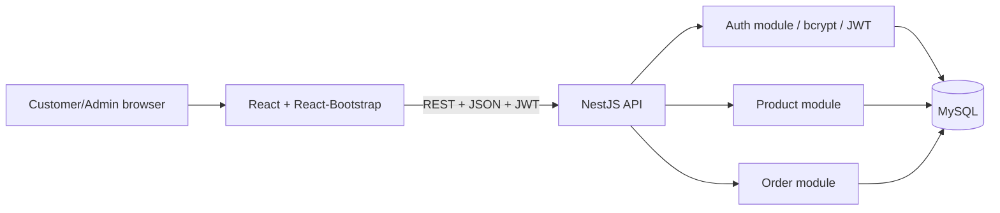

# Architecture

## Trust boundaries
- Browser storage contains a short-lived access token in this demo; XSS defenses and refresh-token strategy should be considered for production.
- NestJS validates DTOs and checks JWT identity and admin role on protected routes.
- MySQL stores password hashes, not plaintext passwords.
- Checkout uses a transaction and row locks to reduce overselling. Validate the exact behavior on the selected MySQL version.
