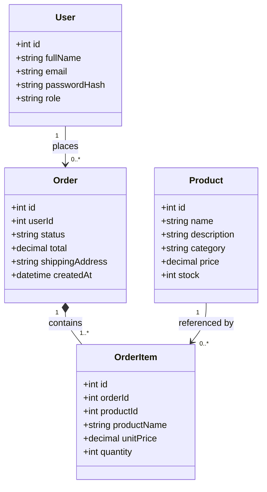
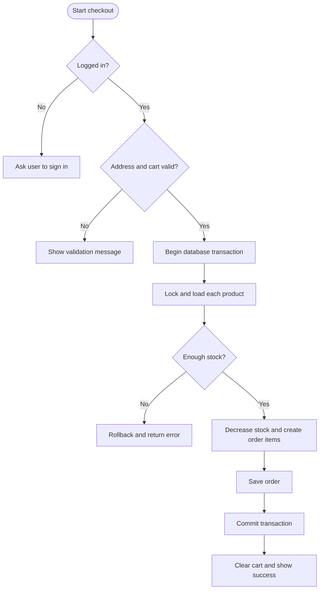

# UML and business model

## Class diagram (Mermaid)

## Checkout activity / algorithm

## Business rules
- Only users with role `admin` can mutate products or manage all orders.
- Product price and stock cannot be negative.
- An order must contain at least one line and a shipping address.
- The checkout process should be atomic: if a line fails validation, stock updates must roll back.
- Order item name and price are snapshots, so later product edits do not change the historic order.
